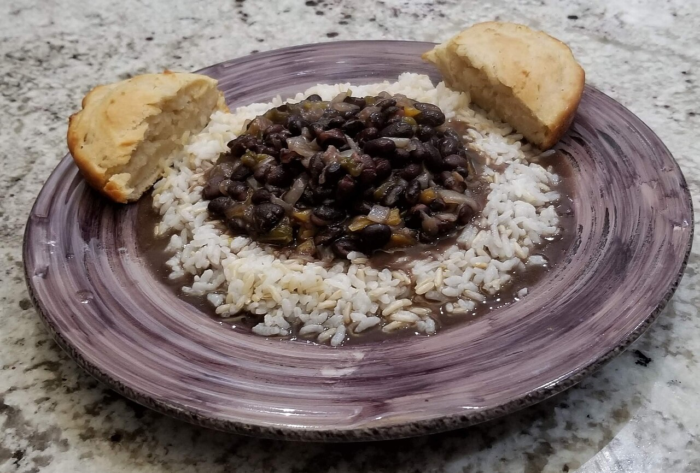

# Black Beans

Instant Pot black beans from dried. No soaking. The cinnamon is not optional.

## Ingredients

- 1 lb dried black beans, rinsed and picked through
- 1 onion, diced
- 4 cloves garlic, minced
- 1 cinnamon stick (or 1/2 tsp ground cinnamon)
- 1 tsp cumin
- 1 bay leaf
- 4 cups water or broth
- Salt
- Olive oil

## Instructions

1. Set the Instant Pot to sauté. Add oil, cook the onion until soft, then the garlic for a minute.

2. Add the beans, water, cumin, cinnamon stick, and bay leaf. Stir.

3. Lock the lid, set to pressure cook on high for 30 minutes. Let it natural release for at least 15 minutes, then quick release the rest.

4. Fish out the cinnamon stick and bay leaf. Salt generously — dried beans need more salt than you think. Taste and adjust.

## Peanut Gallery

**Carolyn:** Cinnamon. In beans. I read that line three times.

**Nate:** I made the same face. Then I ate half the pot standing at the stove.

**Carolyn:** That's not a review, that's a confession.

**Nate:** It doesn't taste like cinnamon. It tastes like the beans cooked for six hours instead of thirty minutes. Just salt them at the end, way harder than feels polite. They're flat right up until the last pinch and then the whole pot wakes up.

**Ben:** Splash of vinegar right before serving. Red wine, sherry, whatever's open.

**Carolyn:** Fine. I made them. The cinnamon stays. I was wrong.

**Nate:** Screenshotting this.

**Carolyn:** I will deny it at dinner.
