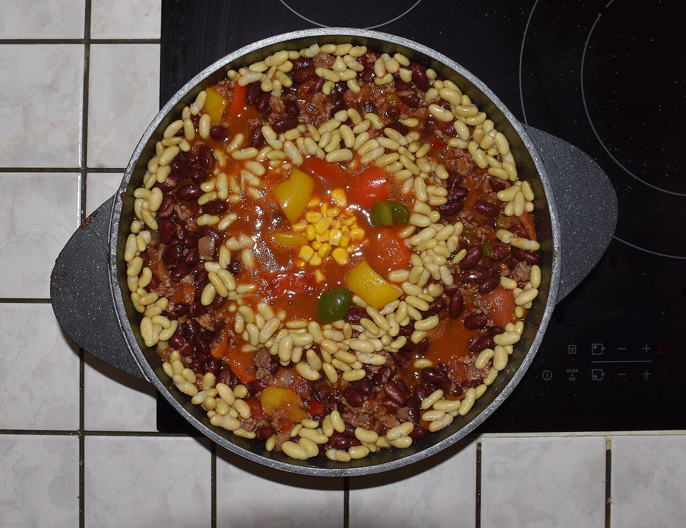

# Chili

Ground turkey and ground beef, roughly half and half. The turkey keeps it from being heavy, the beef keeps it from being boring.

## Ingredients

- 1 lb ground turkey
- 1 lb ground beef (80/20)
- 1 large onion, diced
- 4 cloves garlic, minced
- 2–3 poblano peppers
- 2 cans diced tomatoes
- 1 can kidney beans, drained
- 1 can black beans, drained
- 2 tbsp chili powder
- 1 tbsp cumin
- 1 tbsp cocoa powder
- 1 cup brewed coffee (strong, black)
- Salt and pepper
- Olive oil

## Instructions

1. Roast the poblanos yourself. Put them directly over a gas flame or under the broiler, turning until the skin is blistered and black all over. Drop them in a bowl, cover with plastic wrap, and let them steam for ten minutes. Peel off the skin, remove the seeds, and chop them up.

2. Brown the beef and turkey together in a big pot with some oil. Break it up, season it while it cooks. Pull it out and set it aside.

3. In the same pot, cook the onion until soft, then the garlic for a minute. Add the chili powder, cumin, and cocoa powder and stir it around until it smells like something you want to eat.

4. Add the tomatoes, beans, roasted poblanos, and the meat back in. Pour in the coffee. Stir it all together.

5. Bring it up, then drop it to a low simmer. Let it go for at least an hour, longer if you can. It thickens up and the flavors settle in. Taste and adjust salt.

## Peanut Gallery

**Carolyn:** Cocoa powder AND coffee. He doesn't want you to eat this chili, he wants you to ask about it.

**Tim:** And then he tells you. For a while.

**Ben:** Annoyingly, it's the right call. You don't taste chocolate or coffee. It just tastes darker, like it's been on the stove since yesterday.

**Carolyn:** Roasting your own poblanos on a weeknight is a personality.

**Tim:** Char them all the way black or they won't peel. I got impatient once and spent ten minutes picking skin off with my fingernails like a raccoon.

**Ben:** Make it a day ahead if you can. Day-two chili beats day-one chili every time.

**Carolyn:** Also it needs cornbread, and he knows it needs cornbread.
