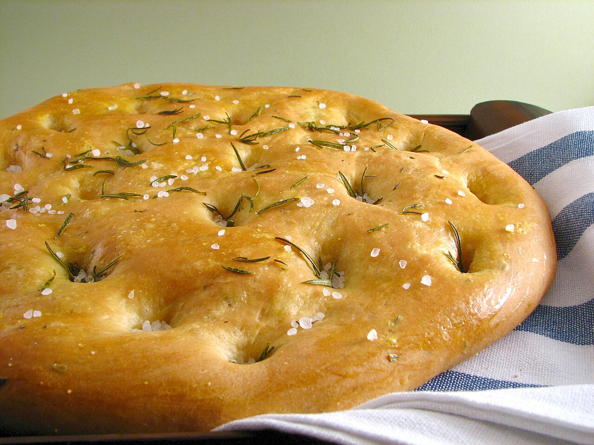

# Focaccia Bread (Alex's Version)

Same dimpled, olive-oil-drenched focaccia, but you jammy-roast a pan of cherry tomatoes and garlic first and press them into the top before it bakes. They collapse into little sweet-savory bombs. This is my version — there will be others.

## Ingredients

- 4 cups (500g) bread flour
- 2 cups warm water
- 2 tsp instant yeast
- 2 tsp fine salt
- 6 tbsp extra-virgin olive oil, divided, plus more for drizzling
- 2 cups cherry tomatoes
- 6 garlic cloves, smashed
- Flaky salt and fresh rosemary, to finish

## Instructions

1. Stir the flour, water, yeast, and fine salt together in a big bowl until it's a shaggy, sticky mess — no kneading. Drizzle a little oil over the top, cover, and let it rise until doubled and bubbly, about 1.5 hours (or overnight in the fridge).

2. While it rises, cook the tomatoes and garlic down. Warm 3 tbsp olive oil in a skillet over medium-low, add the cherry tomatoes and smashed garlic, and let them slump and blister for 12–15 minutes. You want the tomatoes bursting and jammy and the garlic soft and golden — it'll smell sweet and toasty. Let it cool a little.

3. Pour 3 tbsp oil into a 9x13 pan and slosh it around. Scrape the dough in and gently stretch it toward the corners; if it fights back, let it rest 10 minutes and try again. Cover and let it puff for another 30–40 minutes until pillowy.

4. Oil your fingers and dimple the dough all over, going all the way down. Spoon the tomatoes and garlic over the top, pressing them into the dimples along with their oil. Finish with flaky salt and rosemary.

5. Bake at 450°F for 22–25 minutes until deep golden and the edges are crisp. It should sound hollow and the bottom should be lacquered from the oil. Cool in the pan a few minutes, then lift out.

## Peanut Gallery

**Carolyn:** "This is my version — there will be others." He wrote a threat into a bread recipe.

**Nate:** There are two focaccias in this book and I'm not saying which one is better, because I'd like to keep getting fed.

**Tim:** Coward.

**Nate:** Cooking the tomatoes down first is the move, though. Raw ones just steam and make the top soggy.

**Tim:** Save the oil from the tomato pan and brush it on the crust for the last five minutes. Half the flavor is still sitting in that skillet.

**Carolyn:** Tim. That's actually good.

**Tim:** I get one idea a year. That was it.

**Nate:** Do the overnight rise. And use more flaky salt than you think. If the first corner isn't a little too salty, you were shy.
