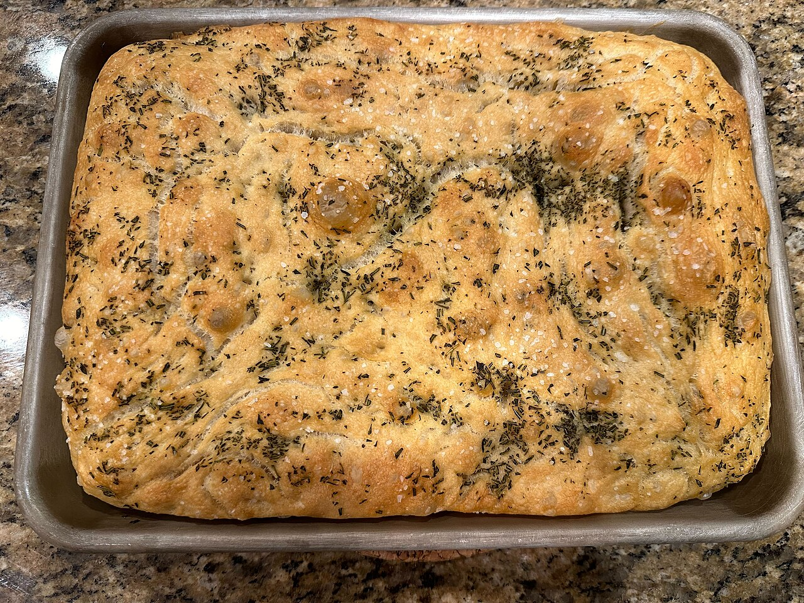

# Focaccia Bread (Ceci's Version)

Same dimpled, olive-oil-drenched focaccia, except you spoon chili crisp oil into every dimple before it bakes. The oil crisps the crust and the little flakes and fried garlic bits toast in the heat. Crunchy, spicy, savory. This is my version — there will be others.

## Ingredients

- 4 cups (500g) bread flour
- 2 cups warm water
- 2 tsp instant yeast
- 2 tsp fine salt
- 3 tbsp extra-virgin olive oil, plus more for the pan
- 3–4 tbsp chili crisp oil (the crunchy kind — Lao Gan Ma, Fly By Jing, whatever you like), well stirred
- Flaky salt and thinly sliced scallions, to finish

## Instructions

1. Stir the flour, water, yeast, and fine salt together in a big bowl until it's a shaggy, sticky mess — no kneading. Drizzle a little olive oil over the top, cover, and let it rise until doubled and bubbly, about 1.5 hours (or overnight in the fridge).

2. Pour a good glug of olive oil into a 9x13 pan and slosh it around. Scrape the dough in and gently stretch it toward the corners; if it fights back, let it rest 10 minutes and try again. Cover and let it puff for another 30–40 minutes until pillowy.

3. Oil your fingers and dimple the dough all over, pressing all the way down. Stir the chili crisp well so you get both the oil and the crunchy bits, then spoon it into the dimples — let it pool. Finish with a little flaky salt.

4. Bake at 450°F for 22–25 minutes until deep golden and the edges are crisp. Watch the chili flakes near the end — you want them toasty and fragrant, not scorched. It should smell like garlic and chili and sound hollow when you tap it.

5. Cool in the pan a few minutes, then lift out and scatter the scallions over the top for a fresh, sharp bite against the heat.

## Peanut Gallery

**Alex:** I would like it on the record that I wrote my focaccia first.

**Carolyn:** Nobody asked.

**Alex:** I would also like it on the record that this one is very good.

**Tim:** Chili crisp on bread sounded like a dare. I ate a third of the pan.

**Alex:** Stir the jar before you spoon. Everybody skims the oil off the top and leaves the crunchy garlic at the bottom. And hold a spoonful back for the last five minutes so the bits toast instead of scorch.

**Carolyn:** Don't skip the scallions. You need something fresh on top or it's oil on oil.

**Tim:** So which focaccia wins?

**Carolyn:** Tim.

**Tim:** I'm just asking what everyone's thinking.
