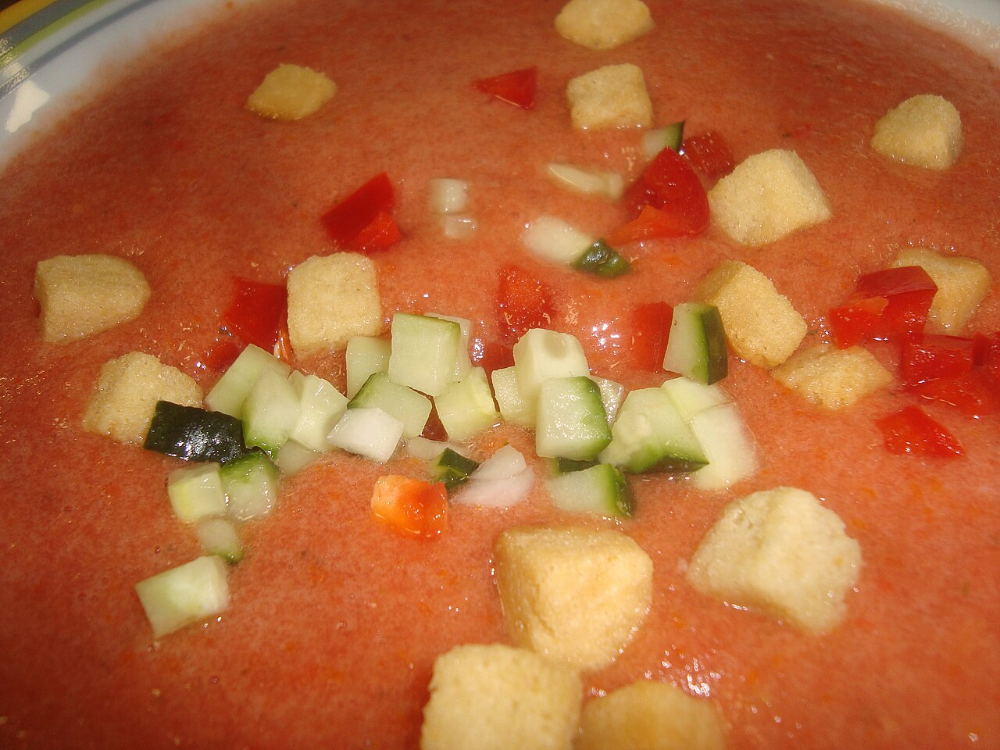

# Gazpacho

Cold tomato soup for when it's too hot to cook. The blender does the work and the fridge does the rest.

## Ingredients

- 2 lbs ripe tomatoes, roughly chopped
- 1 cucumber, peeled and chopped
- 1 green pepper, seeded and chopped
- 1/2 red onion, chopped
- 2 cloves garlic
- 1/4 cup extra virgin olive oil, plus more for drizzling
- 2 tbsp sherry vinegar
- 1 cup day-old bread, torn into pieces and soaked in water
- Salt to taste
- Cold water as needed

## Instructions

1. Soak the bread in water until soft, then squeeze it out. Throw everything — tomatoes, cucumber, pepper, onion, garlic, bread — into a blender and blend until smooth.

2. Drizzle in the olive oil and sherry vinegar while it's running. Season with salt. If it's too thick, add cold water a little at a time until it pours easily but still feels substantial. Strain it if you want it silky, skip if you like some texture.

3. Refrigerate for at least two hours — it needs to be very cold. Serve with a drizzle of olive oil and whatever you want on top: chopped cucumber, pepper, croutons.

## Peanut Gallery

**Alex:** The cucumber doesn't need to be in here. It waters it down.

**Carolyn:** Are you arguing with Ceci?

**Alex:** I'm not arguing with Ceci. I'm arguing with the cucumber.

**Carolyn:** The cucumber stays. Without it you're drinking cold marinara.

**Ben:** Can we go back to the part where there's bread in the soup? Blended? On purpose?

**Carolyn:** It's what makes it creamy without any cream. Keep it. And use real sherry vinegar, not red wine vinegar in a nice bottle.

**Ben:** It has to be painfully cold, too. Two hours minimum. I chill the bowls.

**Alex:** You chill the bowls.

**Ben:** I contain multitudes.
