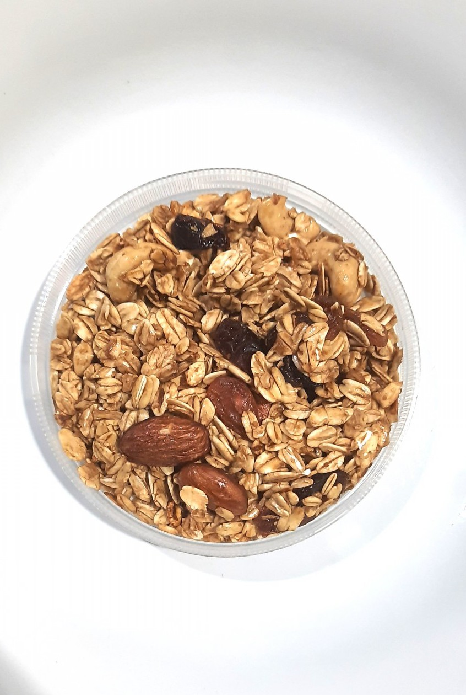

# Granola

Olive oil instead of butter. Pistachios and walnuts. This is the granola.

## Ingredients

- 3 cups old-fashioned oats
- 1 cup raw pistachios, roughly chopped
- 1 cup raw walnuts, roughly chopped
- 1/3 cup olive oil
- 1/3 cup maple syrup or honey
- 1/4 cup brown sugar
- 1 tsp vanilla
- 1/2 tsp cinnamon
- 1/2 tsp salt
- Dried fruit (optional, add after baking)

## Instructions

1. Heat the oven to 325°F. Line a baking sheet with parchment.

2. Mix the oats, pistachios, and walnuts in a big bowl. In a smaller bowl, whisk together the olive oil, maple syrup, brown sugar, vanilla, cinnamon, and salt.

3. Pour the wet over the dry and stir until everything is coated. Spread it out on the baking sheet in an even layer. Press it down a little — this is how you get clusters.

4. Bake for about 30 minutes, stirring once halfway through. It should be golden and fragrant. It'll crisp up more as it cools, so pull it when it still looks slightly underdone.

5. Let it cool completely on the pan without touching it. Break it into pieces. Add dried fruit if you want it.

## Peanut Gallery

**Alex:** I was told this makes a week's worth. It was gone in two days. I'd like to speak to whoever did the math.

**Carolyn:** The math is fine. You're the problem.

**Tim:** Olive oil in granola sounds like a mistake somebody decided to stand behind.

**Alex:** That's what I thought. Then you taste oats and pistachios instead of butter with oats in it, and now I can't eat the boxed stuff.

**Carolyn:** Press it flat before it bakes and do not touch it while it cools. That's where the clusters come from. Stir it warm and you've made expensive cereal.

**Tim:** I touched it while it cooled.

**Carolyn:** I know. I could tell.
