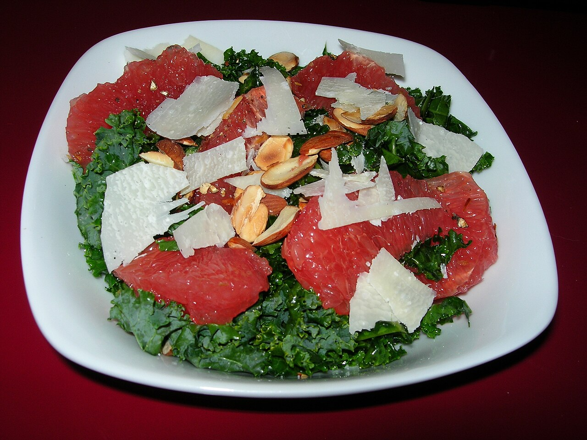

# Kale Caesar Salad

A Caesar that won't turn to soup. The kale holds up, the croutons are homemade, and the dressing hides six anchovies you'll never see coming.

## Ingredients

- 2 bunches Tuscan or curly kale (about 1 lb), stems stripped, leaves roughly chopped
- 5 tbsp olive oil, divided
- 5 oz hearty bread, torn into chunks
- Salt and pepper
- 2/3 cup mayonnaise
- 6 anchovy filets
- 1 garlic clove, minced
- 3/4 cup finely grated Parmesan (about 1 1/2 oz)
- 2 tsp Worcestershire sauce
- 2 tbsp lemon juice (about 1 lemon)
- 1 small white onion or 2 shallots, thinly sliced

## Instructions

1. Strip the kale off its stems, tear the leaves into a big bowl, and pour over 3 tbsp of the oil. Massage it in with your hands for a couple minutes — the leaves should darken, turn silky, and shrink down by half. Set aside.

2. Croutons: pulse the bread with the remaining 2 tbsp oil in a food processor until you've got pea-sized crumbs, then season with salt and pepper. Spread on a sheet pan and bake at 350°F until pale gold and crisp, about 20 minutes. You'll smell toast when they're ready.

3. Wipe out the processor and add the mayo, anchovies, garlic, Parmesan, Worcestershire, and lemon juice. Blitz until smooth and creamy. Taste — it should be punchy and a little salty; nudge with more salt and pepper if it needs it.

4. Toss the kale with the sliced onion, all the dressing, and half the croutons until every leaf is coated. Scatter the rest of the croutons on top and serve.

## Peanut Gallery

**Tim:** Six anchovies. In a salad.

**Ben:** You won't taste fish. They melt into the dressing and it just tastes like Caesar. Leave them out and it's mayo on a leaf.

**Tim:** And then I have to massage the kale. With my hands. Like it had a long week.

**Ben:** Two minutes, with a pinch of salt. When it goes dark and shrinks by half, you're done. Skip it and you're eating a hedge.

**Carolyn:** A hedge with croutons.

**Ben:** Soak the onion slices in cold water for ten minutes while you're at it. Takes the bite off, keeps the crunch.

**Tim:** Okay, I made it. It was even better the next day, which no salad has ever been. I take back the anchovy thing.

**Carolyn:** Nobody take back the hedge thing.
