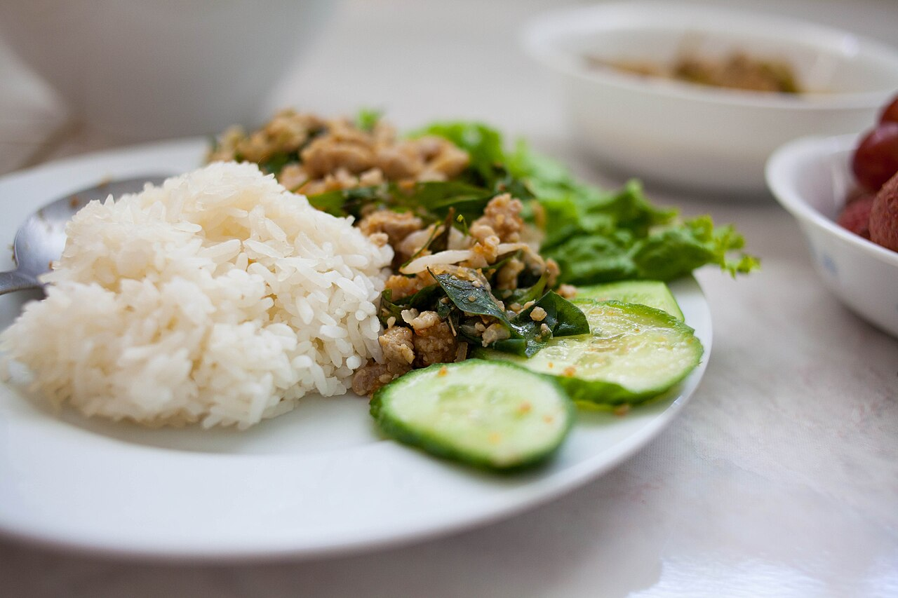

# Larb

Ground turkey larb. The toasted rice powder is the whole thing — don't skip it, don't buy it pre-made.

## Ingredients

- 1 lb ground turkey
- 1/4 cup uncooked jasmine rice (for toasting)
- 3 tbsp fish sauce
- 3 tbsp lime juice (about 2 limes)
- 1 tsp sugar
- 1/2 tsp red pepper flakes or dried chili flakes
- 3–4 shallots, thinly sliced
- Handful of fresh mint leaves
- Handful of fresh cilantro
- Scallions, sliced
- Butter lettuce leaves for serving

## Instructions

1. Toast the rice. Dry skillet, medium heat, toss the raw rice in and shake it around for several minutes until it's golden brown and smells nutty. Let it cool, then grind it in a mortar and pestle or spice grinder until it's a coarse powder. This is what makes it larb.

2. Cook the turkey in a skillet over medium-high heat, breaking it up as it goes. No oil needed — it'll render enough. Season lightly with salt while it cooks.

3. While the meat cooks, mix the fish sauce, lime juice, sugar, and chili flakes together.

4. When the turkey is cooked through, take it off the heat. Pour the dressing over it and toss. Add the shallots, most of the herbs, and the toasted rice powder. Toss again.

5. Serve in lettuce cups with the rest of the herbs on top.

## Peanut Gallery

**Carolyn:** "Don't buy it pre-made." I didn't know rice powder existed until this sentence.

**Ben:** It takes three minutes and it's the only thing in the bowl that crunches. Toast it darker than you think and grind it coarse. You want grit, not flour.

**Carolyn:** I did it in the coffee grinder. The larb was great. The coffee the next morning was a journey.

**Tim:** Three tablespoons of fish sauce and nobody's going to say anything?

**Ben:** It smells like a mistake and tastes exactly right. Dress the meat while it's still warm so it soaks in instead of sliding off.

**Tim:** I trust the fish sauce more than I trust either of you.

**Carolyn:** Correct instinct.
