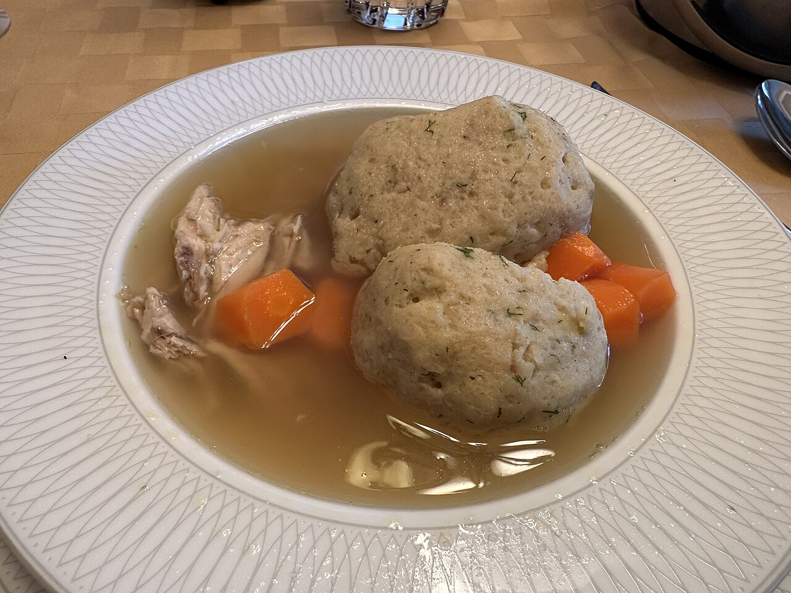

# Matzoh Ball Soup

Fluffy matzoh balls in good chicken broth. The hardest part is leaving the lid alone.

## Ingredients

### Matzoh Balls

- 1 cup matzoh meal
- 4 eggs, beaten
- 1/4 cup schmaltz (or vegetable oil, but schmaltz)
- 1/4 cup broth or seltzer
- 1 tsp salt
- Pinch of white pepper

### Soup

- 8 cups good chicken broth — homemade or the best you can buy
- 2 carrots, peeled and sliced into rounds
- 2 stalks celery, sliced
- Fresh dill for serving

## Instructions

1. Mix the eggs, schmaltz, broth, salt, and pepper together. Stir in the matzoh meal until just combined. Don't overwork it. Cover and refrigerate for at least 30 minutes — the mixture needs to firm up.

2. While the batter chills, bring the chicken broth to a simmer with the carrots and celery.

3. Wet your hands and roll the batter into balls, about the size of a walnut. They'll puff up, so keep them on the smaller side.

4. Drop them gently into the simmering broth. Cover the pot and don't lift the lid for 20 minutes. They need the steam.

5. After 20 minutes, check one. It should be fluffy all the way through, no dense center. Serve with fresh dill on top.

## Peanut Gallery

**Alex:** Don't lift the lid. She said don't lift the lid.

**Carolyn:** Why are you saying it like that.

**Alex:** Because I lifted the lid at twelve minutes. They sank. I've made my peace with it.

**Carolyn:** You have clearly not made your peace with it.

**Nate:** Schmaltz, not oil. The oil ones are fine. The schmaltz ones taste like somebody's grandmother is in the kitchen.

**Carolyn:** What does the seltzer do?

**Nate:** Makes them lighter. Some people use baking powder. Emily uses seltzer, and Emily is right.

**Alex:** Roll them small. They double. I made golf balls once and ended up with softballs.

**Carolyn:** This is the soup you want when you're sick, or sad, or it's just raining.
