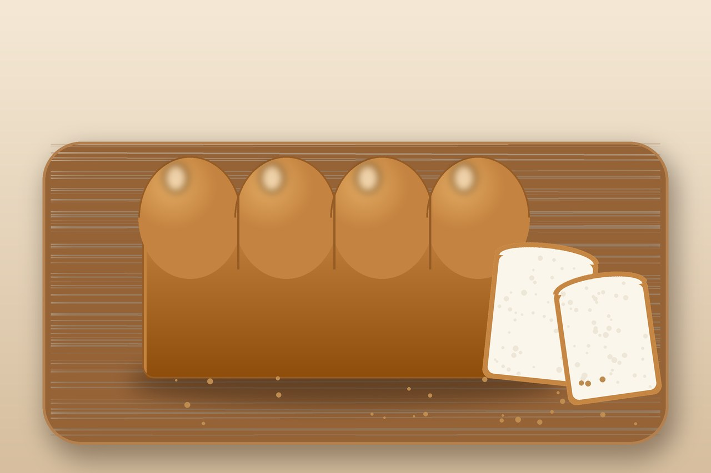

# Milk Bread

Pillowy Japanese-style shokupan. The trick is the tangzhong — a quick cooked flour paste that keeps the crumb soft for days.

## Ingredients

- 2 tbsp bread flour + 1/2 cup milk (for the tangzhong)
- 2 1/2 cups bread flour
- 1/4 cup sugar
- 2 1/4 tsp instant yeast
- 1 tsp salt
- 1/2 cup warm milk
- 1 egg
- 3 tbsp soft butter
- 1 egg beaten with a splash of milk (for the wash)

## Instructions

1. Make the tangzhong: whisk the 2 tbsp flour into the 1/2 cup milk in a small pot over medium heat, stirring constantly until it thickens into a loose paste you can draw a line through — about 2 minutes. Let it cool to warm.

2. In a big bowl, mix the bread flour, sugar, yeast, and salt. Add the warm milk, egg, and the cooled tangzhong. Mix into a shaggy dough, then knead. Once it comes together, work in the soft butter a bit at a time. Keep kneading until it's smooth, tacky, and stretches thin without tearing — about 10 minutes.

3. Cover and let it rise somewhere warm until doubled and puffy, roughly 1 hour. Press a finger in; the dent should spring back slowly.

4. Punch it down, divide into 3 or 4 pieces, roll each flat, fold, and roll into logs. Tuck them seam-side down into a buttered loaf pan. Cover and proof again until they crest just over the rim, about 45 minutes.

5. Brush with the egg wash and bake at 350°F until deep golden and hollow-sounding when tapped, 30–35 minutes. Turn it out and cool before you tear in — the steam is still setting the crumb.

## Peanut Gallery

**Tim:** You cook a paste. Then you make a dough. Then it rises twice. This is sandwich bread with a project plan.

**Carolyn:** The paste is the entire point. It's why the loaf is still soft on day three, when normal bread is toast-only.

**Tim:** It is never going to see day three.

**Nate:** Can I throw the butter in at the start with everything else?

**Carolyn:** No.

**Nate:** What if I just

**Carolyn:** No. Gluten first, butter after. Add it early and you're kneading a greasy puddle for twenty minutes.

**Nate:** Asking for a friend who already did it.

**Carolyn:** Stretch a piece of dough thin. If you can see light through it before it rips, stop kneading. If it rips, keep going. And pull the paste off the heat the second your spoon leaves a line. It turns to glue fast.

**Tim:** Made it. Tore it apart with my hands like an animal. I retract everything.
