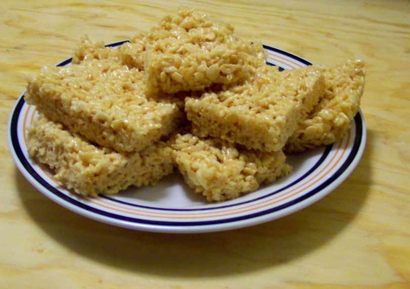

# Rice Krispy Treats

The classic, with two small upgrades: a pinch of salt and a little vanilla.

## Ingredients

- 6 cups Rice Krispies cereal
- 1 bag (10 oz) marshmallows
- 3 tbsp butter
- Pinch of salt
- 1/2 tsp vanilla (optional but better)

## Instructions

1. Melt the butter in a big pot over low heat. Add the marshmallows and stir constantly until they're completely melted and smooth. Take it off the heat.

2. Stir in the salt and vanilla if you're using it. Pour in the cereal and fold it together gently. You want every piece coated but you don't want to crush them.

3. Press into a buttered 9x13 pan. Don't press too hard — if you compact them, they'll be dense and chewy instead of light and crispy. Use a piece of wax paper or wet hands to pat them down.

4. Let them cool completely before cutting. Or don't. Nobody actually waits.

## Peanut Gallery

**Alex:** Three ingredients. One of them is marshmallows.

**Carolyn:** And you have still managed to mess them up.

**Alex:** I added things.

**Carolyn:** You always add things. Emily follows the recipe and hers are perfect every time. Sit with that.

**Ben:** Don't mash them into the pan. Pat them down like you're tucking them in. Press hard and you could tile a bathroom with them.

**Alex:** The salt matters. Make them once without it and they just taste like "sweet."

**Ben:** Brown the butter first. Take it a little past melted, until it smells nutty.

**Carolyn:** Ben. "She follows the recipe" was ten seconds ago.

**Ben:** It's still three ingredients.

**Alex:** "Let them cool completely before cutting. Or don't. Nobody actually waits." Finally, a recipe that gets me.
