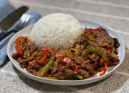

# Ropa Vieja

Shredded flank steak simmered with tomato, peppers, and wine. It starts with meat you've already cooked, so it comes together fast.

## Ingredients

- 2 lbs flank steak, cooked ahead of time in broth or soup
- 1/3 cup oil
- 1 onion, thinly sliced into rounds
- 2 cloves garlic, crushed
- 1 large ají (cubanelle or green pepper), cut into strips
- 1 can tomato sauce
- 1 bay leaf
- 1 tsp salt
- 1/2 cup dry white wine
- 1 can roasted red peppers (pimientos morrones)

## Instructions

1. Shred the cooked flank steak into thin threads or strips with your hands.

2. Slice the onion into thin rounds and cut the pepper into strips. Crush the garlic and fry it in the hot oil, then add the onion. Once softened, add the pepper and cook a bit more.

3. Add the shredded meat and all remaining ingredients — tomato sauce, bay leaf, salt, wine. The roasted peppers can go in chopped, blended into the sauce, or saved whole to lay on top as garnish — your call. Stir to combine.

4. Cover and simmer over low heat for 15–20 minutes, stirring occasionally so it doesn't stick. You'll know it's ready when it smells deep and savory and the sauce clings to the meat.

5. Serve with white rice and a fresh salad.

## Peanut Gallery

**Alex:** "Cooked ahead of time in broth" is tucked into the ingredient list like it's nothing. It's the whole recipe.

**Carolyn:** I used fresh steak the first time. It was fine. It was not this.

**Tim:** It means "old clothes." We're all just okay with that?

**Alex:** Best-named dish in the book. Shred it by hand until it looks like the name. Forks leave it chunky.

**Carolyn:** Two cloves of garlic is a suggestion.

**Alex:** You say that on every recipe.

**Carolyn:** And I've been right on every recipe. Also, blend half the roasted peppers into the sauce and lay the rest on top.

**Alex:** That's not in the recipe.

**Carolyn:** It is now.

**Tim:** White rice. Double batch. Better tomorrow. That's all I've got.
